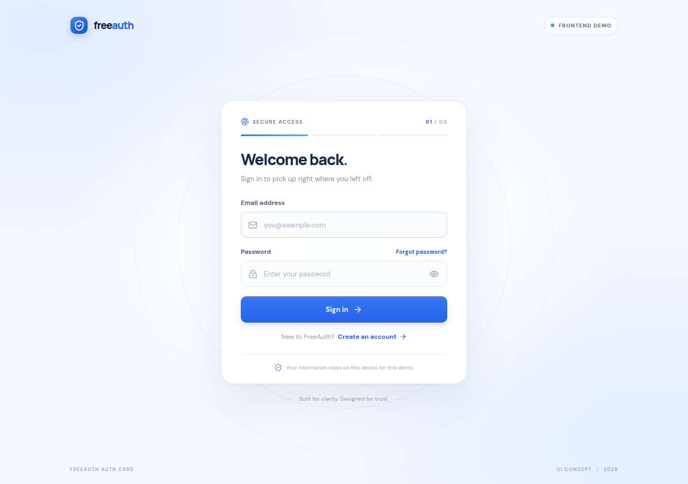
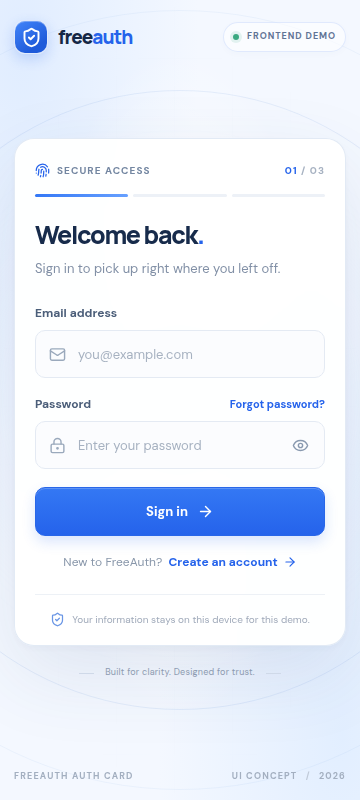

# FreeAuth — Auth Card

A small, responsive authentication UI exercise built with React, TypeScript, Vite, and Tailwind CSS. It brings sign-in, account creation, and email-code verification together in one card. All requests are simulated in the browser; there is no backend and no real account is created.

## Overview

FreeAuth demonstrates three connected interface states:

- **Login:** email and password, a show/hide control, basic validation, and loading, error, and success feedback.
- **Register:** email, password, confirmation, a live strength indicator, and a transition to verification after the simulated request.
- **OTP verification:** six individual digit fields with automatic focus advance, backspace navigation, arrow-key navigation, and full-code paste support.

The layout is keyboard accessible and designed to remain usable at 360px wide. The six-digit demo code is `123456`.

## Getting started

Requirements: Node.js 20.19+ or 22.12+, and Corepack.

```bash
corepack pnpm install
corepack pnpm dev
```

Open the local URL printed by Vite (normally `http://localhost:3000`). To produce and check a production build:

```bash
corepack pnpm build
corepack pnpm preview
```

### Try the mock flows

Use any valid-looking email and any non-empty password to see a simulated sign-in success. Use the password `wrong` (or an email containing `blocked`) to see the mock sign-in error. In Register, use any valid-looking email, a password of at least eight characters, and a matching confirmation; an email containing `taken` simulates an already-registered address. The registration flow advances to OTP. Enter `123456` to verify, or another six-digit code to see the error state.

These branches are intentionally predictable for review; they are not authentication rules and should never be treated as security controls.

## Project structure

```text
freeauth/
├── public/
│   ├── freeauth-mark.svg         # Small custom shield mark / favicon
│   └── manus-routes.json         # Declares the single page route
├── src/
│   ├── components/
│   │   ├── NoticeBanner.tsx      # Accessible result feedback
│   │   ├── OtpInput.tsx          # Six-digit input, paste and focus behavior
│   │   └── PasswordStrength.tsx  # Live strength feedback
│   ├── lib/
│   │   └── auth.ts               # Email validation, strength, mock timer
│   ├── types/
│   │   └── auth.ts               # Shared typed view and notice models
│   ├── App.tsx                   # Screen state, forms, validation, mock flows
│   ├── main.tsx                  # React entry point
│   └── styles.css                # Tailwind import and responsive visual system
├── docs/screenshots/
│   ├── freeauth-login.png        # Desktop sign-in screenshot
│   └── freeauth-mobile-360.png   # 360px responsive check
├── index.html
├── package.json
├── pnpm-lock.yaml
├── pnpm-workspace.yaml
├── tsconfig*.json
└── vite.config.ts
```

## Screenshot

Desktop sign-in view:



The layout was also captured at the required 360px width:



## How auth works

This project only draws and simulates an authentication flow. A real application needs a trusted server to make the security decisions:

1. **Registration:** the user submits an email and password over HTTPS. The server should never store the raw password. It stores a salted, deliberately slow password hash using a password-hashing algorithm such as Argon2id (or an appropriately configured alternative), so a database leak does not directly reveal users’ passwords.
2. **Email verification:** the server creates a short-lived, one-time verification code, sends it to the address, and checks the submitted code on the server. The code should expire, be limited to its intended purpose, and be protected by attempt and resend limits. Verifying an email proves access to that mailbox; it does not by itself prove a person’s identity.
3. **Login:** after checking the password against its stored hash and applying any account policies, the server issues an access token with a relatively short lifetime and a refresh token with a longer lifetime. An access token is presented to authorize requests. A refresh token is used only with the authentication service to request renewed access.
4. **Refresh:** when the access token expires, the client can present a still-valid refresh token to the authentication service and obtain a new access token without asking the user to enter the password again. A real system must also handle refresh-token expiry, revocation, and theft; rotation is commonly used. Tokens are not automatically safe just because they are called “tokens.” Their storage and transport need an intentional design (for example, carefully configured `HttpOnly`, `Secure` cookies for browser sessions).

Exact token formats and storage depend on the system. An access token does not have to be a JWT, and refresh tokens can be opaque. FreeAuth does **not** hash passwords, send email, verify real OTPs, issue tokens, persist a session, or contact an authentication API. The code `123456` and all outcomes are local UI-demo behavior only.

## Decisions & notes

- **Design:** I followed the approved calm-tech direction: cool blue accents, a pale grid-and-orbit backdrop, precise borders, and restrained motion. The card stays visually central and keeps the action and status easy to find.
- **Component boundaries:** the OTP input and password-strength indicator are separate components because their interaction rules are specific and worth reviewing independently. Shared email validation and the mock timer live in `src/lib/auth.ts`; the screen flow remains in `App.tsx`.
- **Validation and states:** the demo uses explicit branches and a short `setTimeout` wrapper so loading and outcomes can be inspected without a server. The messages avoid pretending that a real account, email, or token exists.
- **AI use:** I used Manus AI to help break the brief into components, scaffold the React/TypeScript implementation, and draft this documentation. I checked the generated behavior against the requested flow, retained the explicit six-digit paste/backspace/focus behavior, and kept the demo-only security boundary visible. I did not add a backend or real credential handling because the brief explicitly asks for a `setTimeout` mock. Before submitting, review this section and edit it so it accurately reflects your own process and voice.
- **Limits / uncertainty:** password strength here is a friendly input hint, not a security assessment. The sample login and OTP results are hard-coded. Production token storage, email delivery, code expiry, rate limits, and account recovery depend on the backend and threat model; this prototype makes no claim to have solved them.

---

Made as a self-contained frontend candidate exercise. No production credentials should be entered here.
